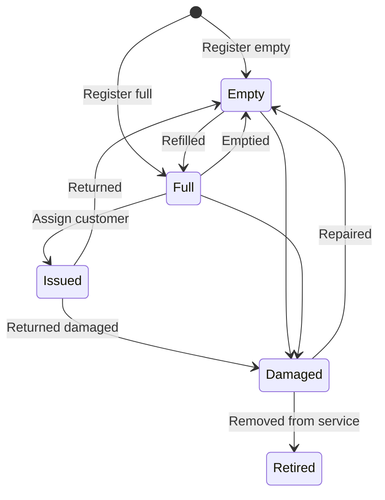
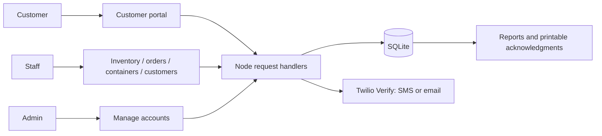

# Implementation and demonstration guide

Updated 21 September 2026. This document describes implemented behavior; it does not replace adviser approval of changes to the proposal.

## Proposal alignment

| Area | Implementation | Evidence |
|---|---|---|
| Inventory | Product CRUD, stock-in/out, thresholds and movement history | System tests verify stock deduction once for pickup and delivery. |
| Container tracking | Unique physical tags; empty/full/issued/damaged/retired; customer assignment; append-only history | System tests cover registration, duplicate rejection, invalid transitions, issue/return and history. |
| Customer information | Customer CRUD plus a consolidated printable history page | Server and browser checks verify orders and container events in history. |
| Scheduling | Scheduled → out for delivery → awaiting customer → delivered | Tests verify premature receipt rejection, valid completion, and blocking restart/cancellation after completion. |
| Payments and credit (approved additions) | Manual payments, reference/proof review, partial balances and due dates | Payment tests cover access restrictions, approval, overpayments and settlement. |
| Receipt acknowledgment | Numbered print page for approved payments only | Tests check amount, stable number and customer ownership. |
| Authentication | Roles, password hashes, provider-backed registration/recovery | Account tests use a mock provider. Live delivery is still unverified. |
| Activity records | Successful signed-in write requests are recorded without request bodies | Tests check activity creation and absence of passwords. |

Activity history is a request-level trail, not a full before/after archive. Container events and payment review records retain more detailed changes. Failed actions are not stored in the activity report.

## Container rules

Tag each reusable station container with a unique code, such as OLV-001. Register the actual opening inventory of physical containers; the system does not invent these from product quantities.

Each change needs a note and stores the staff user. Retired containers cannot be issued again. The SQL history trigger and status update are one database operation. Customers with container history cannot be permanently deleted; archive them instead.

This is a station-owned reusable-container ledger. Customer-owned bottles, deposits, lost-container charges and supplier returns are not automatically inferred. Confirm the station's actual procedure during acceptance testing.

## Main data flow

Update the manuscript's use cases, role descriptions, data dictionary, and DFDs to include approved additions. The original PDF's exclusion of online payment processing still applies: this system records manually verified transfers; it does not charge GCash/bank accounts. Provider-backed OTP should be described explicitly if retained despite the original SMS limitation.

## Code responsibilities

- `app.js`: existing HTTP routes, inventory/order operations, authentication boundary and module wiring.
- `routes/stationRecords.js`: staff-only container records and customer history.
- `routes/payments.js`: payment ledger, credit terms, proof access and receipt authorization.
- `utils/paymentReceipt.js`: escaped printable acknowledgment HTML; never a tax-invoice claim.
- `utils/activityLog.js`: request-level successful-write logging.
- `routes/accountVerification.js` and `utils/verification.js`: verification tickets, attempt limits, provider interaction and safe password recovery.
- `public/js/containers.js`, `customer-history.js`, `payments.js`: corresponding browser controls.
- `scripts/verify-system-flows.js`: real HTTP and headless-browser checks against isolated fixtures.

The server remains responsible for permissions and validation even if somebody bypasses the UI. The browser displays useful errors and prevents routine mistakes, but it is not the security boundary.

## Demonstration sequence

1. Sign in as staff and open Containers. Register a real sample tag as empty.
2. Mark it full, issue it to a sample customer, then return it empty. Show the history.
3. Open Customers → View history. Show that both issue and return belong to that customer.
4. Place a pickup order as the customer, confirm collection, and show the inventory reduction.
5. Place a delivery order, record dispatch/drop-off as staff, then confirm receipt as the customer. Explain that a photo is optional.
6. Record part of the payment. Approve credit terms for the balance. Show the outstanding credit report.
7. Record the rest of the payment. Show that the credit balance clears and print a payment acknowledgment.
8. Show the activity report and explain what it does and does not log.

Use test records, not invented acceptance results. Understand and explain each flow in your own words, and follow your school's rules on acknowledging assistance.

## Remaining external work

- Configure a real Twilio Verify account plus SMS destination access and email sender/template; test delivery to actual authorized recipients.
- Have the owner confirm physical container states, operational roles, credit rules and opening balances.
- Complete the acceptance checklist with the actual tester, date, observations and signatures.
- Review deployment settings, HTTPS and database backup/restore procedures before any public deployment.

Passing automated checks is evidence for the tested cases, not a claim of 100% defect-free software or adviser approval.

## Supported delivery locations

Customer registration, portal delivery details, staff customer records, and delivery forms use City / Municipality with Legazpi City and Daraga. Customer profile and registration endpoints reject unsupported locations. Existing unsupported addresses are not rewritten automatically; select a supported location when editing them.

## Account email check

Manage Accounts now includes email and verification status in the customer list and editor. Demonstrate searching by email and explain the separate code-confirmation step for saving a replacement address. SMS registration retains optional email as unverified. Automated email tests use a simulated provider; the full browser/system suite currently passes 60 checks on an isolated database.

## Delivery, inventory and report follow-up

See SYSTEM_REVIEW.md for driver assignment and permissions, atomic manual stock adjustments, CSV export and simplified route modules. The latest full browser/system suite passes 85 checks.
